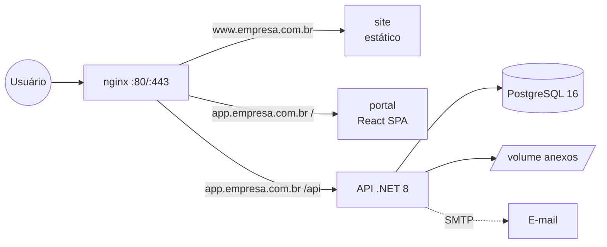

# Arquitetura

Parte de [[00 - Visão Geral]].

## Roteamento por subdomínio



O portal e a API compartilham o domínio `app.empresa.com.br` — o frontend chama `/api/...` com **caminho relativo**, eliminando CORS em produção (em dev, proxy do Vite → `localhost:8080`).

## Containers (docker-compose)

| Serviço | Imagem | Papel |
|---|---|---|
| `nginx` | nginx:1.27-alpine | Reverse proxy por subdomínio + TLS |
| `site` | build de `/site` | HTML estático servido por nginx interno |
| `portal` | build de `/portal` | Vite build servido por nginx interno (SPA fallback) |
| `api` | build de `/api` (SDK 8 → aspnet 8) | API + migrations/seed automáticos na subida |
| `postgres` | postgres:16-alpine | Banco, com healthcheck que segura a API |
| `certbot` | certbot/certbot (profile) | Emissão/renovação de certificados sob demanda |

Volumes: `pgdata` (banco), `anexos` (comprovantes), `certbot-www`/`certbot-conf` (ACME).

## Estrutura do repositório

```
/api      .NET 8 Web API + EF Core + xUnit
  src/Empresa.Api/{Domain,Data,Auth,Services,Controllers,Dtos,Migrations}
  tests/Empresa.Api.Tests
/portal   React (Vite) PWA — src/{pages,components,utils}
/site     index/servicos/sobre/contato.html + css
/infra    nginx/nginx.conf
docker-compose.yml · .env.example · README.md
```

## Decisões de projeto

1. **Máquina de estados pura** (`DespesaWorkflow`, classe estática sem EF/IO) → testável unitariamente sem banco. Ver [[03 - Máquina de Estados]].
2. **Valores monetários `decimal`** de ponta a ponta (`numeric(12,2)` no Postgres) — nunca float.
3. **Storage abstraído** (`IArquivoStorage`): implementação atual grava em volume Docker com caminhos *relativos* (`ano/mês/despesa-N/guid.jpg`), o que vira chave S3 sem migração de dados — só troca de implementação.
4. **Audit log append-only**: serviço só tem método `Registrar`; nenhum endpoint edita/apaga.
5. **Enums persistidos como string** no banco (legibilidade em queries manuais).
6. **Rejeição preserva histórico**: reenvio marca aprovações como `Ativa=false` em vez de apagar.
7. **E-mail nunca derruba requisição**: falha de SMTP é logada; com `SMTP_HOST` vazio, e-mails só vão para o log (modo dev).
