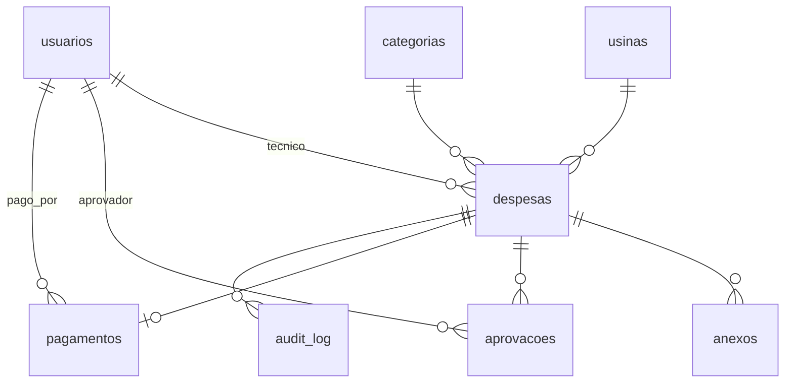

# Modelo de Dados

Parte de [[00 - Visão Geral]]. PostgreSQL 16, EF Core 8, migration `Initial`.

## Tabelas

### usuarios
`id, nome, email (único), senha_hash (BCrypt), papel, ativo` (+ chave_pix legada, sem uso)
- Papéis ativos: `Administrativo | Aprovador | Financeiro | Admin` (`Tecnico` é legado — técnicos não têm login desde 2026-06-12; os antigos ficaram `ativo=false`)

### tecnicos *(novo, 2026-06-12 — migration `TecnicosSeparados`)*
`id, nome, chave_pix, tipo_chave_pix, ativo`
- Cadastro **sem login**: define para quem (e para qual chave PIX) vai cada reembolso
- Tipos de chave: `Cpf | Email | Telefone | Aleatoria` — **validação de formato** em `PixValidator` (CPF com dígitos verificadores, e-mail, E.164 BR, UUID)
- A migration copiou os antigos usuários-técnicos preservando IDs (despesas existentes continuam válidas); `despesas.tecnico_id` agora referencia esta tabela

### usinas
`id, nome, cliente, cidade, ativo`

### categorias
`id, nome, limite_por_item numeric(12,2) NULL, comprovante_obrigatorio, ativo`
- Limite **não bloqueia** o envio; despesa acima aparece destacada em vermelho para os aprovadores

### despesas
`id, tecnico_id, usina_id, categoria_id, data_gasto (date), valor numeric(12,2), descricao, status (string), criado_em, motivo_rejeicao`
- `motivo_rejeicao` é denormalizado da última rejeição, para exibição rápida no app do técnico
- Índices: `(tecnico_id, data_gasto, valor)` → alerta de duplicidade; `(status)` → filas

### anexos
`id, despesa_id, caminho_arquivo (relativo ao storage), tipo_mime, tamanho`
- Mimes aceitos: jpeg/png/webp/pdf, máx. 10 MB

### aprovacoes
`id, despesa_id, aprovador_id, decisao (Aprovada|Rejeitada), motivo, data, ativa`
- `ativa=false` quando a despesa é reenviada após rejeição (histórico preservado)

### pagamentos
`id, despesa_id (1:1), pago_por_id, data_pagamento, chave_pix_usada, tipo_chave_pix_usada, observacao`
- **`chave_pix_usada` é congelada** no momento do pagamento — trocar a chave depois não altera o registro

### audit_log — *append-only*
`id, despesa_id, usuario_id, acao, estado_anterior, estado_novo, detalhe, timestamp`
- Nunca editado nem apagado; registra também exportação de CSV, alteração de chave PIX e de configurações

### configuracoes
`chave (PK), valor` — ex.: `prazo_lancamento_dias = 30`

## Seed inicial

1 admin, 2 aprovadores, 1 financeiro, 2 técnicos (senha `Senha@123`), categorias **alimentação (R$60), combustível (R$400), hospedagem (R$250), pedágio (R$100), outros (sem limite)** — todas com comprovante obrigatório — e 2 usinas de exemplo. Ver [[08 - Runbook]].
