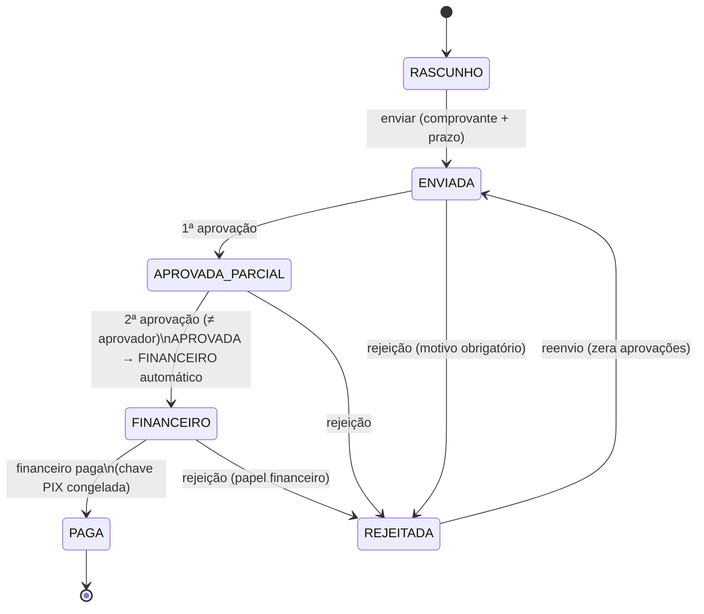

# Máquina de Estados da Despesa

Parte de [[00 - Visão Geral]]. Implementada em `api/src/Empresa.Api/Domain/DespesaWorkflow.cs` como **classe estática pura** (sem EF/IO) — por isso 100% coberta por testes unitários sem banco.

## Regras (todas com teste)

| Regra | Teste |
|---|---|
| Enviar exige comprovante se a categoria obriga | `Enviar_SemComprovante_QuandoCategoriaExige_Bloqueia` |
| Prazo de lançamento N dias (config, padrão 30); limite exato passa | `Enviar_ForaDoPrazoDeLancamento_Bloqueia` / `ExatamenteNoLimite` |
| Data futura e valor ≤ 0 bloqueiam | `Enviar_DataNoFuturo_Bloqueia` / `ValorZeroOuNegativo` |
| 1ª aprovação → APROVADA_PARCIAL | `PrimeiraAprovacao_VaiParaAprovadaParcial` |
| 2ª aprovação (aprovador distinto) → FINANCEIRO **automático** | `SegundaAprovacao_…_VaiAutomaticamenteParaFinanceiro` |
| Aprovações independentes, qualquer ordem | `AprovacoesIndependentes_OrdemNaoImporta` |
| Mesmo aprovador não aprova 2× | `MesmoAprovador_NaoPodeAprovarDuasVezes` |
| **Ninguém aprova/rejeita a própria despesa** | `NinguemAprovaAPropriaDespesa` / `NinguemRejeita…` |
| Só papel `aprovador` aprova; inativo não aprova | `ApenasAprovadorPodeAprovar` / `AprovadorInativo_NaoAprova` |
| Rejeição: motivo obrigatório, qualquer etapa antes de PAGA | `Rejeitar_SemMotivo_Bloqueia` / `Rejeitar_DespesaPaga_Bloqueia` |
| Na etapa FINANCEIRO, só o financeiro rejeita (ex.: PIX recusado) | `Financeiro_PodeRejeitar_NaEtapaFinanceiro` |
| Reenvio zera aprovações (ficam `ativa=false`, histórico preservado) | `Reenvio_AposRejeicao_ZeraAprovacoesAnteriores` |
| Após reenvio, precisa **novamente** de 2 aprovações | `AposReenvio_PrecisaNovamenteDeDuasAprovacoes` |
| Pagamento congela a chave PIX do momento | `MarcarPaga_CongelaChavePixDoMomento` |
| Técnico sem chave PIX não recebe | `MarcarPaga_TecnicoSemChavePix_Bloqueia` |
| Edição só em RASCUNHO/REJEITADA (aprovada/paga imutável) | `Edicao_SoEmRascunhoOuRejeitada` |

**69 testes** no total (incluindo `PixValidatorTests`). Rodar: `cd api && dotnet test`.

## Nota de implementação

O estado `APROVADA` existe na máquina conceitual, mas a transição `APROVADA → FINANCEIRO` é automática e atômica na segunda aprovação — o código grava **duas entradas no audit log** (`aprovou_despesa` com estado novo `Aprovada` + `transicao_automatica_financeiro`) e persiste o status final `Financeiro`. Nenhuma despesa "fica parada" em APROVADA.

Violações de regra lançam `DomainException`, que o middleware converte em **HTTP 422** com `{ "erro": "mensagem" }`.
